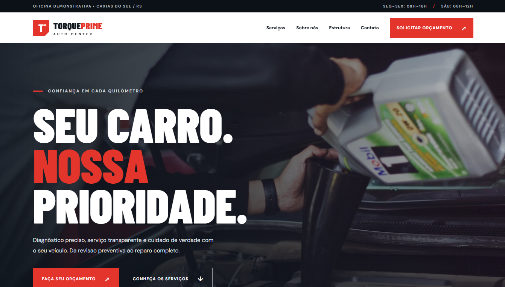
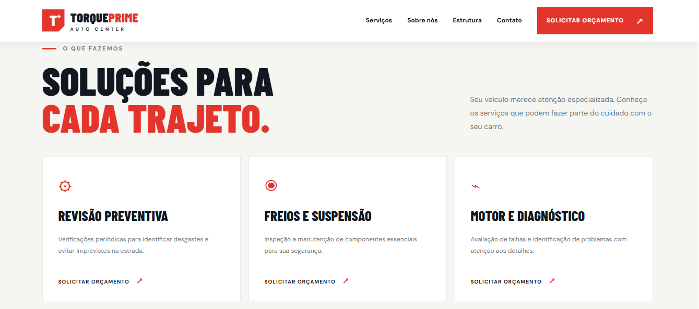
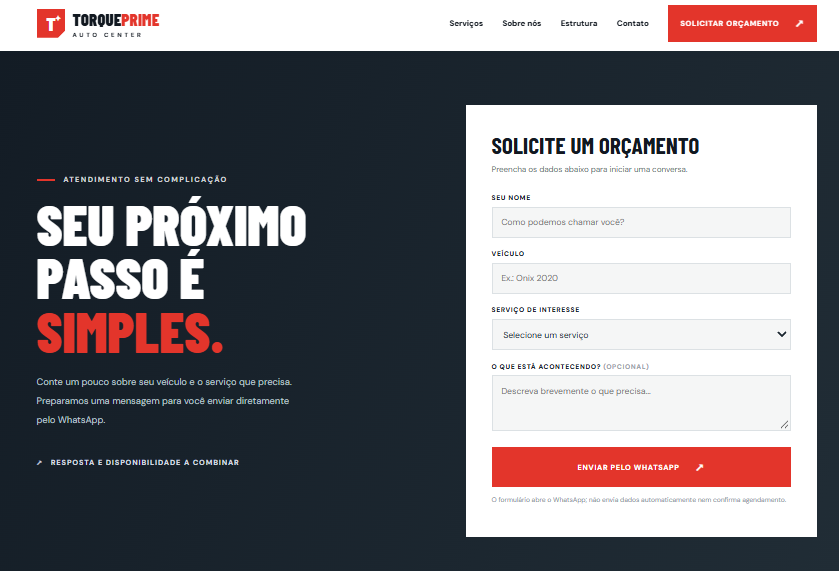
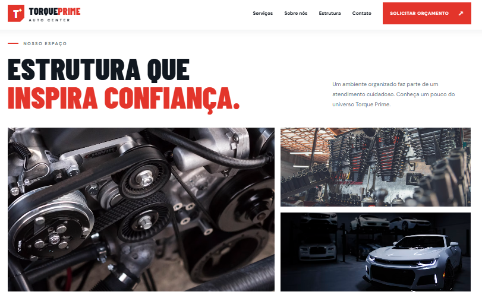
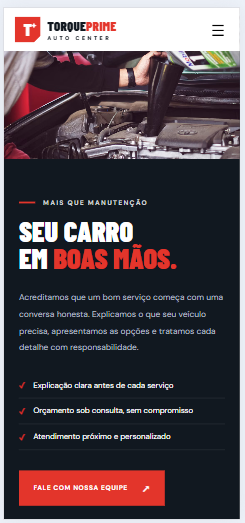

# 🔧 Torque Prime — Auto Center

Site demonstrativo de uma oficina mecânica, desenvolvido com **HTML, CSS e JavaScript**, com foco em apresentação profissional de serviços e solicitação de orçamento via WhatsApp.

## 🌐 Projeto online

Acesse o site publicado:

https://jefersonalvesrs.github.io/torque-prime/

## 🖼️ Pré-visualização

### Página inicial



### Serviços



### Solicitação de orçamento



### Estrutura da oficina



### Versão mobile



## ✨ Funcionalidades

- Página inicial com apresentação da oficina
- Catálogo de seis categorias de serviços
- Botões que selecionam automaticamente o serviço no formulário
- Seção institucional e galeria de fotografias
- Formulário com nome, veículo, serviço e descrição opcional
- Mensagem de orçamento preparada para envio pelo WhatsApp
- Menu de navegação adaptado a dispositivos móveis
- Layout responsivo

## 🛠️ Tecnologias

- HTML5
- CSS3
- JavaScript
- Git e GitHub
- GitHub Pages (publicação planejada)

## 📂 Estrutura do projeto

```text
oficina-mecanica/
├── assets/
│   └── images/
│       ├── oficina-inicio.png
│       ├── oficina-servicos.png
│       ├── oficina-orcamento.png
│       └── oficina-mobile.png
├── imagens/
│   ├── hero.jpg
│   ├── sobre.jpg
│   ├── galeria-1.jpg
│   ├── galeria-2.jpg
│   └── galeria-3.jpg
├── index.html
├── style.css
├── script.js
└── README.md
```

## ⚙️ Personalização

Para adaptar o site a uma oficina real, substitua nome, endereço, horários, descrições, fotografias e número de WhatsApp (`WHATSAPP_NUMBER` em `script.js`). As imagens demonstrativas carregadas por links externos devem ser substituídas por arquivos locais com licença de uso adequada.

O formulário apenas abre o WhatsApp com uma mensagem preenchida; **não envia dados automaticamente e não confirma agendamentos**.

## 📌 Aviso

**Torque Prime é uma empresa fictícia.** Informações de atendimento, serviços e imagens são ilustrativas. Projeto criado para fins de estudo, portfólio e demonstração comercial.
